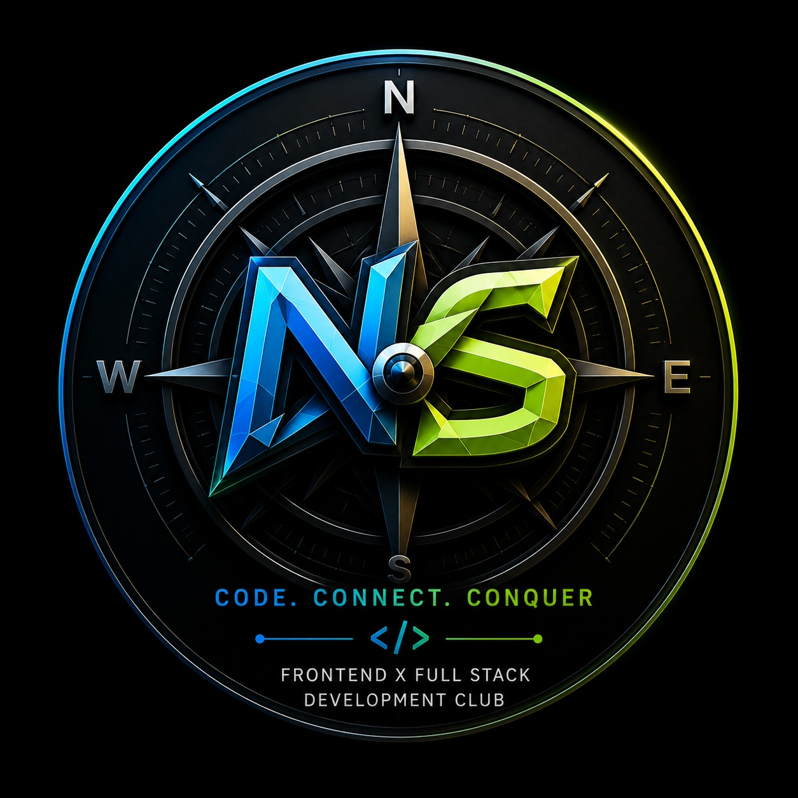
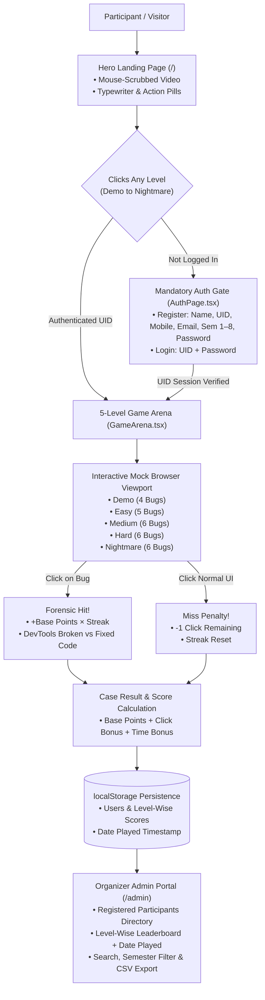
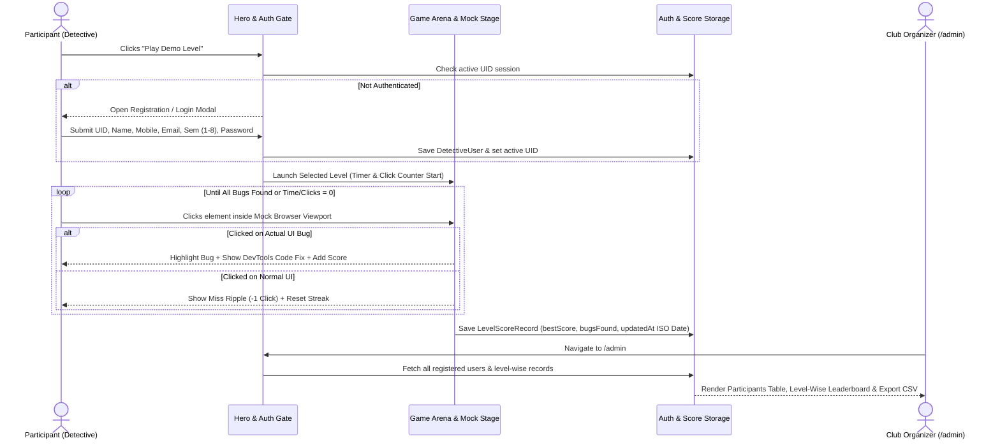

# FRONTENDIVE® by NexaSoul ✳︎

> **Developed by Sumanshu Jindal for NexaSoul Club, Chandigarh University**  
> *CODE. CONNECT. CONQUER — `</>` Frontend × Full Stack Development Club*

<p align="center">
  
  &nbsp;&nbsp;&nbsp;&nbsp;
  
</p>

---

## Overview

**FRONTENDIVE®** is an interactive **Frontend UI Detective Web Game** engineered for **NexaSoul Club, Chandigarh University**. Players step into the role of a Frontend Forensics Detective tasked with inspecting realistic, live web interfaces and spotting subtle visual, layout, CSS, accessibility, and state bugs under strict **time** and **click** constraints.

The platform blends an editorial, **mouse-scrubbed full-screen video landing experience** with a **mandatory UID authentication gate**, **5 progressive difficulty levels** (each containing up to **6 handcrafted UI errors**), a live **NexaSoul DevTools Code Forensics Inspector**, and a dedicated **`/admin` Organizer Portal** with level-wise leaderboards and CSV exports.

### Official Links
- **NexaSoul Website:** [https://nexasoul.vercel.app](https://nexasoul.vercel.app) (`nexasoul.vercel.app`)
- **NexaSoul Linktree:** [https://linktr.ee/nexasoul_cu](https://linktr.ee/nexasoul_cu)

---

## Key Features

1. **Mouse-Scrubbed Interactive Video Hero Landing Page**
   - Full-viewport `<video>` background controlled smoothly by horizontal mouse movement (`SENSITIVITY = 0.8`) with an `onSeeked` queue guard to prevent seek flooding.
   - Custom `HelveticaNowDisplay-Medium` and `HelveticaNowDisplayW01-Rg` typography, `4px` blurred intro headline, custom `useTypewriter` hook (`38ms`/char, `600ms` start delay) with blinking cursor, and `400ms` staggered action pill buttons.
2. **Mandatory Participant Registration & UID Login Gate**
   - No participant can enter or play any level without first authenticating.
   - **Registration Fields:** Full Name, University ID (`UID`), Mobile Number, Email ID, Semester (`1–8`), and Password.
   - **Login Fields:** Registered `UID` and Password.
3. **5 Progressive Detective Levels (Max 6 UI Errors Per Screen)**
   - **DEMO**, **EASY**, **MEDIUM**, **HARD**, and **NIGHTMARE** tiers.
   - Clicking directly on a broken UI element captures the defect, awards base points multiplied by the active streak (`1x`, `1.25x`, `1.5x`), and reveals the **Broken Code vs. Fixed Code** inside the **NexaSoul DevTools Audit Panel**.
   - Clicking on normal (non-buggy) UI elements triggers a miss ripple (`-1 Click`) and resets the combo streak.
4. **Organizer Admin Console (`/admin`)**
   - Direct `/admin` route displaying real-time KPIs, a **Registered Participants Directory**, and a **Level-Wise Leaderboard** (`All Levels`, `DEMO`, `EASY`, `MEDIUM`, `HARD`, `NIGHTMARE`) complete with **Date & Time Played**, search, semester filtering (`Sem 1–8`), and one-click **CSV Export**.

---

## Table 1: Technology Stack & Architecture

| Layer / Category | Technology / Specification | Purpose in FRONTENDIVE® | Primary Source Files |
| :--- | :--- | :--- | :--- |
| **Core UI Framework** | **React 18** (`^18.3.1`) | Component state management, modal routing, timer lifecycle, and interactive mock stages | `src/App.tsx`, `src/main.tsx` |
| **Language & Typing** | **TypeScript 5** (`^5.6.3`) | Strict compile-time types for levels, UI bug specs, participant credentials, and scores | `src/data/levels.ts`, `src/types/auth.ts` |
| **Build Tool & Bundler** | **Vite 6** (`^6.0.1`) | Instant HMR development server (`:5173`), SPA `/admin` route handling, and optimized production bundle | `vite.config.ts`, `package.json` |
| **Styling & Design System** | **Tailwind CSS 3** (`^3.4.17`) + Custom CSS | Editorial light-mode theme (`#f4f3ef`), responsive grid layouts, frosted glass HUDs, and keyframe animations | `src/index.css`, `tailwind.config.js` |
| **Typography** | **Helvetica Now Display** (`Medium` & `Regular`) | Loaded via stylesheet links and exposed through `--font-heading` and `--font-body` CSS variables | `index.html`, `src/index.css` |
| **Persistence & Telemetry** | **Browser Web Storage (`localStorage`)** | Stores registered detective profiles, active UID sessions, level-wise high scores, and `updatedAt` timestamps | `src/types/auth.ts`, `src/components/AdminPortal.tsx` |

---

## Table 2: 5-Level Game Progression & UI Error Matrix

| Level Tier | Case Code & Mock Website Theme | UI Errors (Max 6) | Click Limit | Time Limit | Base Pts / Bug | Accuracy & Speed Bonuses | Featured Frontend Defects to Identify |
| :--- | :--- | :---: | :---: | :---: | :---: | :--- | :--- |
| **1. DEMO** | `CASE #00` — **Bean & Byte Artisanal Café** | **4 Bugs** | 10 Clicks | 120s | `100 pts` | `+50 pts/click`<br>`+10 pts/sec` | `rotate-180` upside-down CTA, crushed `line-height: 0.55`, broken local `C:\Users\...` image path, overflowing float price tag |
| **2. EASY** | `CASE #01` — **PulseCloud SaaS Pricing** | **5 Bugs** | 9 Clicks | 90s | `150 pts` | `+75 pts/click`<br>`+15 pts/sec` | `z-index` badge collision over toggle, raw `${plan.starterPrice}/mo` string leak, 1.12:1 WCAG contrast fail, stretched avatar, broken flex alignment |
| **3. MEDIUM** | `CASE #02` — **KicksVault Streetwear Drop** | **6 Bugs** | 9 Clicks | 75s | `250 pts` | `+90 pts/click`<br>`+20 pts/sec` | Search icon overlapping input text, `-1` cart badge state bug, `6/5` rating stars loop error, clipped CTA text (`h-6 overflow-hidden`), wrapped size tile, `© NaN` footer year |
| **4. HARD** | `CASE #03` — **QuantPay FinTech Terminal** | **6 Bugs** | 8 Clicks | 60s | `350 pts` | `+120 pts/click`<br>`+25 pts/sec` | Green upward badge on negative PnL, premature `max-w-[68px] truncate`, unstyled square tab token, clipped chart tooltip, `$€ EUR` currency mismatch, displaced `×` close icon |
| **5. NIGHTMARE** | `CASE #04` — **NexaSoul AI Cluster OS** | **6 Bugs** | 7 Clicks | 45s | `500 pts` | `+200 pts/click`<br>`+40 pts/sec` | `5px` breadcrumb baseline shift, inverted toggle switch (ON track + OFF knob), `108%` VRAM bar overflow, Times New Roman serif leak, stuck focus ring on disabled item, double border + `&amp;nbsp;` entity leak |

---

## Diagram 1: System Architecture & Mandatory Auth Flow



---

## Diagram 2: Gameplay & Admin Telemetry Sequence



---

## Project Directory Structure

```text
Frontendive/
├── index.html                        # HelveticaNowDisplay font links & root mount
├── package.json                      # Scripts & dependencies (React, Vite, Tailwind, TS)
├── vite.config.ts                    # Vite bundler configuration
├── tailwind.config.js                # Custom font families & Tailwind scan paths
├── postcss.config.js                 # PostCSS configuration
├── public/
│   └── assets/
│       ├── compass-logo.jpeg         # NexaSoul Compass Emblem
│       └── nexasoul-logo.png         # NexaSoul 3D Wordmark Logo
└── src/
    ├── main.tsx                      # React DOM entry point
    ├── index.css                     # Font variables & keyframe animations
    ├── App.tsx                       # Main router (/ vs /admin), Auth Gate, Modal state
    ├── types/
    │   └── auth.ts                   # DetectiveUser & LevelScoreRecord storage helpers
    ├── hooks/
    │   └── useTypewriter.ts          # Custom typewriter effect hook
    ├── data/
    │   └── levels.ts                 # All 5 levels & 27 handcrafted UI bug specifications
    └── components/
        ├── Navbar.tsx                # Fixed z-20 frosted header + mobile menu overlay
        ├── HeroLanding.tsx           # Mouse-scrubbed video hero + pills + quick level card
        ├── AuthPage.tsx              # Mandatory Registration (Sem 1-8, UID) & Login modal
        ├── GameArena.tsx             # Live HUD, timer, click tracker, DevTools inspector
        ├── MockLevelStages.tsx       # 5 interactive mock website stages with clickable bugs
        ├── LevelSelectorModal.tsx    # 5-Level Case File selector & public scoreboard
        ├── InfoModals.tsx            # Field Manual ("How to Play") & NexaSoul Club modal
        ├── AdminPortal.tsx           # /admin Organizer Console + Level Leaderboard + CSV export
        └── Footer.tsx                # Official NexaSoul footer & external links
```

---

## Getting Started Locally

### 1. Install Dependencies
```bash
npm install
```

### 2. Start the Development Server
```bash
npm run dev
```
- **Main Web Game:** `http://localhost:5173/`
- **Organizer Admin Portal:** `http://localhost:5173/admin`

### 3. Build for Production
```bash
npm run build
```

---

## Credits & Attribution

- **Game Concept & Engineering:** **Developed by Sumanshu Jindal for NexaSoul Club, Chandigarh University**
- **Club:** **NexaSoul — Frontend × Full Stack Development Club**
- **Official Website:** [nexasoul.vercel.app](https://nexasoul.vercel.app)
- **Linktree:** [https://linktr.ee/nexasoul_cu](https://linktr.ee/nexasoul_cu)

